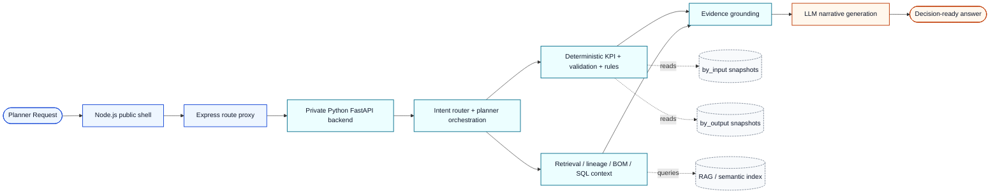
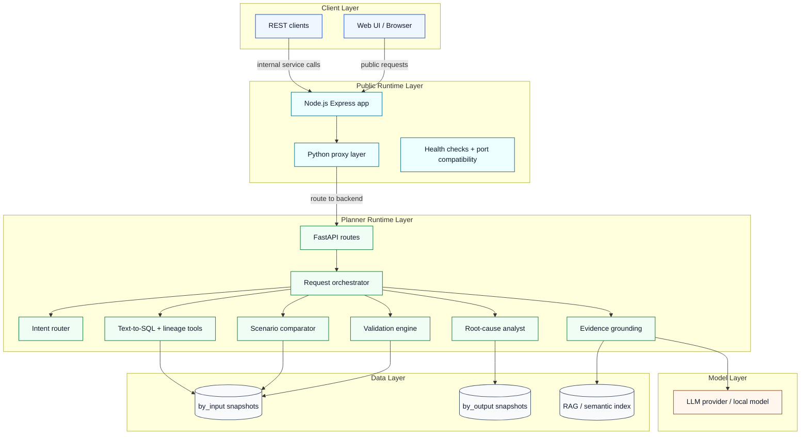
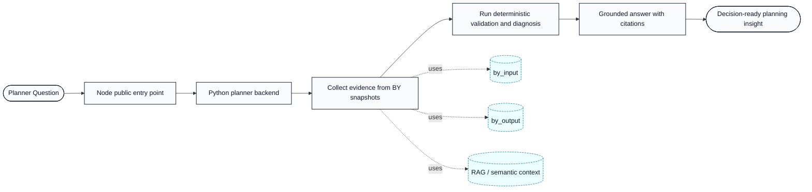
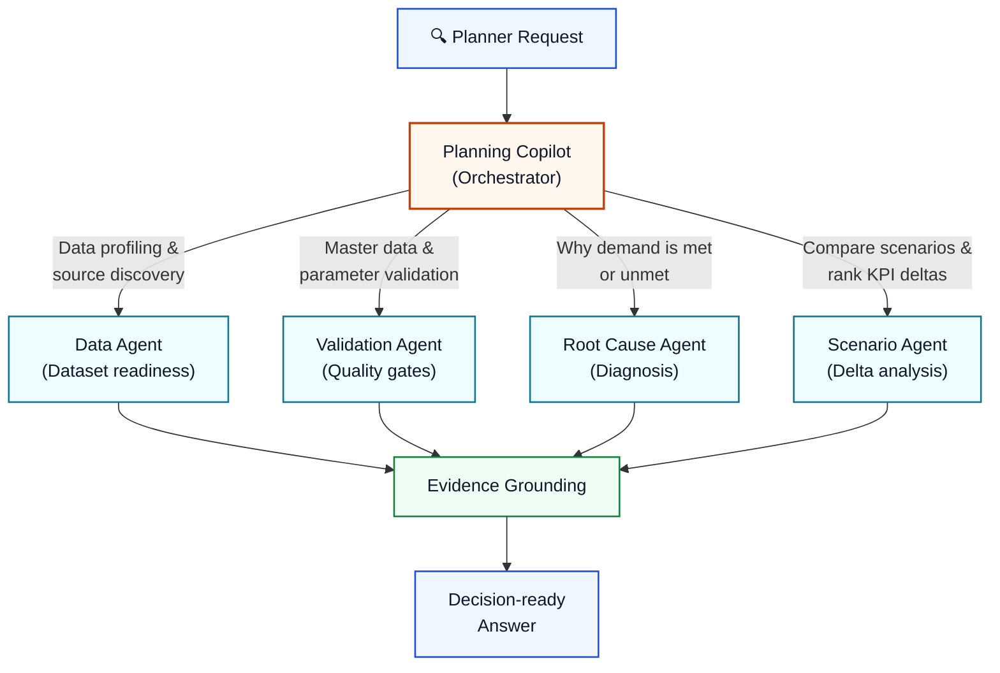

<p align="center">
  
</p>

<h1 align="center">Intel Foundry Supply Planning AI Assistant</h1>

<p align="center">
  Enterprise-grade explainability for BY ESP planning snapshots
</p>

<p align="center">
  <a href="https://github.com/jyotiranjanojha/ifsupplystory/actions/workflows/semantic-regression.yml">
    
  </a>
  <a href="https://github.com/jyotiranjanojha/ifsupplystory/actions/workflows/semantic-regression.yml">
    
  </a>
  
  
</p>

<p align="center">
  
  
  
</p>

---

## Why This Project

This assistant helps planners ask natural-language questions and receive grounded answers using:

- Deterministic planning logic for KPIs, validation, and constraints
- Structured retrieval over BY input and output snapshots
- LLM-based intent understanding and explanation generation
- Evidence-first responses with citations and confidence metadata

Built for planning teams that need explainability, traceability, and operational confidence.

### Key Capabilities

- Demand and supply diagnosis
- Scenario comparison and delta ranking
- Root-cause explainability for shortages and lateness
- Validation gates for master data and solver outputs
- BOM and lineage traversal workflows
- Text-to-SQL exploration with safety checks
- Optional RAG-backed evidence retrieval

### Executive Summary

| Focus Area | Description |
|---|---|
| Explainability | Deterministic evidence and auditable response grounding |
| Planning Intelligence | Intent-driven workflow routing and domain-aware analysis |
| Data Foundation | BY snapshot integration across by_input and by_output |
| Delivery | API-first service with web UI and semantic quality gates |

---

## Quick Navigation

- [Tech Stack](#tech-stack)
- [Model Support](#model-support)
- [Architecture](#architecture)
- [Core Components](#core-components)
- [Data Sources](#data-sources)
- [API Endpoints](#api-endpoints)
- [Getting Started](#getting-started)
- [Configuration](#configuration)
- [Testing](#testing)
- [Semantic Regression](#semantic-regression)
- [Troubleshooting](#troubleshooting)
- [Additional Documentation](#additional-documentation)

---

## At a Glance

| Category | Stack |
|---|---|
| Public Entry Point | Node.js + Express |
| Planning Engine | Python + FastAPI + Uvicorn |
| Data | BY ESP CSV snapshots (by_input and by_output) |
| Explainability | Deterministic KPI, rule, and lineage engines plus grounded LLM narratives |
| Runtime Pattern | Hybrid compatibility shell: public Node app, private Python backend |
| Quality Gate | Semantic regression with CI thresholds |

---

## Tech Stack

<p>
  
  
  
  
  
  
  
  
  
  
  
  
</p>

| Layer | Technology | Icon |
|---|---|---|
| Public API Shell | Node.js + Express |   |
| Planning Backend | FastAPI |  |
| Runtime Language | Python 3.11+ |  |
| API Server | Uvicorn |  |
| Container Runtime | Docker / Compose |  |
| Data Processing | Pandas and NumPy |   |
| Validation Models | Pydantic |  |
| Workflow Orchestration | LangGraph and domain orchestrators |  |
| Testing | pytest |  |
| Semantic Quality Gate | Custom semantic regression framework |  |
| Vector and Retrieval | FAISS-based vector storage and RAG indexing |   |
| Frontend | HTML templates with JavaScript client |   |

## Model Support

The service supports multiple LLM providers for planner-facing explanation workflows.

### Supported Providers

| Provider | Typical Use |
|---|---|
| nollama | Local OpenAI-compatible inference |
| openai | Hosted OpenAI models |
| azure | Azure OpenAI deployments |
| anthropic | Claude-based hosted inference |
| openvino | Local optimized inference workflows |
| custom | Organization-specific adapter path |

### Model Configuration

Set provider and model in .env. Example for local Nollama:

```dotenv
LLM_PROVIDER=nollama
NOLLAMA_BASE_URL=http://localhost:8000
NOLLAMA_MODEL=Qwen2.5-Coder-7B-Instruct@GPU
```

Runtime checks:

- GET /api/llm/models returns discoverable models
- GET /api/config returns active runtime configuration

For provider-specific setup details, see LLM_PROVIDER_GUIDE.md.

---

## Architecture

### High-Level Flow



### Runtime Components



### Executive View (One-Page)



---

## Core Components

| Area | Responsibility |
|---|---|
| Node Public Shell | Express layer for public-facing API and host compatibility |
| Python Backend | FastAPI planning engine, routes, and deterministic logic |
| Orchestration | Intent-driven workflow routing and response assembly |
| Intent Router | Intent catalog, entities, confidence handling |
| KPI Engine | Deterministic KPI calculations and checks |
| BOM Workflow | Multi-step BOM traversal and evidence synthesis |
| SQL Agent | NL-to-SQL pipeline with validation and retries |
| Grounding | Evidence envelope, citations, confidence mapping |
| RAG | Indexing and retrieval over planning assets |

---

## Agent Suite

The application uses a delegation-based agent architecture where the **Planning Copilot** orchestrates requests to specialized agents, each with distinct responsibilities for planning explainability and validation.

### Agent Architecture



### Agent Roles

#### 1. IFSP Planning Copilot (Orchestrator)
**Role**: Workflow orchestrator and request router

- Routes planner requests to the right specialist agent based on intent
- Combines grounded evidence from multiple sources
- Ensures audit-trail compliance and confidence metadata
- Enforces guardrails: no fabricated data, clear hypothesis distinction

**Delegation Logic**:
- Data profiling, ingestion, source discovery → Data Agent
- Master data, BOM, parameter, output sanity validation → Validation Agent
- Why demand is met/unmet, lineage diagnosis, solver outcome explanation → Root Cause Agent
- Week-to-week or scenario-to-scenario delta analysis → Scenario Agent

**Output Format**:
1. Question Type
2. Scope (week, scenario, entities)
3. Evidence Used
4. Findings
5. Root Cause or Validation Result
6. Confidence and Data Gaps
7. Recommended Next Checks

#### 2. IFSP Data Agent (Specialist)
**Role**: Data profiling and ingestion validation

- Identifies source type: Snowflake, CSV upload, or shared path
- Inventories input and output datasets relevant to the question
- Profiles schema, keys, row counts, and identifier coverage
- Flags data gaps and provides required fields for downstream analysis

**Constraints**:
- DO NOT run root-cause conclusions
- DO NOT infer solver behavior
- ONLY produce dataset readiness and schema-grounded findings

**Use When**:
- Profiling IFSP input/output datasets
- Checking dataset readiness and completeness
- Identifying required tables/files
- Mapping schema and key coverage
- Preparing Snowflake and CSV data context

**Output Format**:
1. Data Scope
2. Datasets Found
3. Schema and Key Coverage
4. Data Quality Flags
5. Missing Data and Access Gaps
6. Recommended Next Retrievals

#### 3. IFSP Validation Agent (Specialist)
**Role**: Quality gates and readiness checks

- Validates master data completeness and key consistency
- Validates BOM and alternate BOM integrity
- Validates planning parameters (lead time, lot sizing, sourcing, capacity)
- Validates output sanity versus business rules and expected ranges
- Classifies issues by severity and planning impact

**Constraints**:
- DO NOT perform scenario comparison unless explicitly requested
- DO NOT provide speculative solver causes without validation evidence
- ONLY return defects and risks traceable to data checks

**Use When**:
- Validating IFSP master data
- Checking BOM integrity
- Reviewing planning parameters
- Running output sanity checks before solve or explainability
- Assessing readiness for planning runs

**Output Format**:
1. Validation Scope
2. Evidence Used
3. Checks Executed
4. Issues Found (Critical, High, Medium, Low)
5. Readiness Verdict (Pass, Conditional Pass, Fail)
6. Likely Planning Impact
7. Recommended Fixes
8. Confidence and Data Gaps

#### 4. IFSP Root Cause Agent (Specialist)
**Role**: Demand-supply diagnosis and lineage tracing

- Traces lineage from unmet demand to potential constraints
- Identifies confirmed causes and distinguishes them from hypotheses
- Quantifies impact where data supports it
- Connects planning inputs to solver outcomes
- Retrieves demand, supply, capacity, BOM, and parameter evidence

**Constraints**:
- DO NOT fabricate lineage paths
- DO NOT skip master data and parameter defects when they affect conclusions
- ONLY provide confirmed root causes when evidence is sufficient

**Use When**:
- Explaining why demand is met or unmet
- Diagnosing BY ESP planning constraints
- Tracing lineage and linkage across BY input and output data
- Performing root-cause analysis for shortages and lateness
- Connecting planning inputs to solver outcomes

**Output Format**:
1. Explainability Scope
2. Evidence Used
3. Confirmed Findings
4. Root Causes
5. Hypotheses and Missing Evidence
6. Confidence Level
7. Recommended Next Checks

#### 5. IFSP Scenario Agent (Specialist)
**Role**: Scenario comparison and delta analysis

- Compares scenarios using grounded evidence
- Explains largest planning deltas and their drivers
- Ranks KPI deltas by impact
- Identifies drivers via master data, BOM, parameter, and output changes
- Validates comparability of keys, granularity, and metrics

**Constraints**:
- DO NOT compare datasets with mismatched metric definitions without flagging comparability risk
- DO NOT mix weeks/scenarios without explicit normalization
- ONLY report ranked deltas supported by data

**Use When**:
- Comparing IFSP scenarios within a week or across weeks
- Ranking KPI deltas
- Identifying key drivers behind plan differences
- Analyzing scenario trade-offs
- Running weekly scenario comparison workflows

**Output Format**:
1. Comparison Scope
2. Evidence Used
3. Top Delta Metrics (ranked)
4. Confirmed Drivers
5. Hypotheses and Data Gaps
6. Confidence Level
7. Recommended Next Checks

### Agent Communication Pattern

```
Planner Question
    ↓
Planning Copilot (validates scope, determines intent)
    ↓
Route to Specialist Agent(s)
    ↓
Specialist executes deterministic checks with BY snapshots
    ↓
Evidence collection and confidence assessment
    ↓
LLM narrative generation (grounded in collected evidence)
    ↓
Decision-ready answer with citations and confidence metadata
```

### Architecture Principles

All agents follow these principles:

- **Snowflake as Source of Truth**: Use Snowflake when access is available
- **SQL Retrieval**: Use SQL for structured planning facts
- **Lineage Traversal**: Use genealogy analysis for root-cause explanation
- **Business Rules Explicit**: Keep checks explicit and evidence-linked
- **Evidence-First Approach**: Avoid unsupported claims; label hypotheses clearly
- **Data Accuracy**: Never fabricate data, lineage, or solver behavior

---

## Data Sources

### BY Input Snapshot Folder: by_input

Contains planning master and policy inputs such as:

- Items, locations, calendars
- BOM and alternates
- Production and purchase methods
- Sourcing policies
- Inventory and customer orders

### BY Output Snapshot Folder: by_output

Contains solver outcomes such as:

- Demand views and links
- Planned orders and purchases
- Resource load details and exceptions
- SKU-level projection and exception outputs

### Integration Scope

- Read-only explainability over exported BY ESP snapshots
- No write-back to BY ESP from this service
- Uses BY naming and linkage conventions for joins and context resolution

---

## API Endpoints

| Method | Endpoint | Purpose |
|---|---|---|
| GET | /api/health | Service health |
| GET | /api/config | Active semantic mode and diagnostics |
| GET | /api/datasets/summary | Dataset inventory summary |
| GET | /api/llm/models | Available model list |
| POST | /api/validate | Validation checks |
| POST | /api/compare | Scenario comparison |
| POST | /api/root-cause | Root-cause analysis |
| POST | /api/sql-query | Natural language to SQL |
| POST | /api/chat | Non-streaming chat |
| POST | /api/chat/stream | Streaming chat (SSE) |
| POST | /api/rag/reindex | Build or rebuild RAG index |
| POST | /api/rag/query | Query RAG |

For the complete endpoint set, see webapp/app/main.py.

---

## Getting Started

### Prerequisites

- Windows, Linux, or macOS
- Python 3.11+
- pip

### Setup Environment

```bash
python -m venv .venv

# Windows PowerShell
.venv\Scripts\Activate.ps1

# Linux or macOS
source .venv/bin/activate

pip install --upgrade pip
pip install -r webapp/requirements.txt
```

### Create Environment File

```bash
# Windows PowerShell
Copy-Item .env.example .env

# Linux or macOS
cp .env.example .env
```

### Minimum Required Settings

```dotenv
LLM_PROVIDER=nollama
NOLLAMA_BASE_URL=http://localhost:8000
NOLLAMA_MODEL=Qwen2.5-Coder-7B-Instruct@GPU
SEMANTIC_MODE=legacy
```

### Run the Application

The current runtime pattern is a hybrid deployment:

- Public entry point: Node.js app on port 3004
- Private planning engine: Python FastAPI app on an internal port such as 8000, 8001, or 8002

#### Start the Python backend

```bash
# Windows PowerShell
.\.venv\Scripts\Activate.ps1
python webapp/run.py --host 127.0.0.1 --port 8000
```

#### Start the public Node shell

```bash
npm install
npm start
```

Then open in browser: http://localhost:3004

For containerized deployment, the project also supports a combined startup script and Docker Compose flow with the backend kept internal-only while the public Express app serves the front door.

---

## Configuration

### Semantic Mode Rules

- SEMANTIC_MODE is required
- Exactly one value must be set
- Allowed values:
  - legacy
  - semantic_retrieval
  - hybrid
  - solver_explainability

### Optional Security Controls

```dotenv
API_AUTH_ENABLED=false
API_AUTH_TOKEN=
RATE_LIMIT_ENABLED=false
RATE_LIMIT_WINDOW_SECS=60
RATE_LIMIT_PER_WINDOW=120
RATE_LIMIT_STRICT_PER_WINDOW=30
```

---

## Testing

### Run Full Test Suite

```bash
pytest tests -q
```

### Run Focused Suites

```bash
pytest tests/test_semantic_mode_config.py -q
pytest tests/test_kpi_engine.py -q
pytest tests/test_hybrid_router.py -q
pytest tests/semantic -rA
```

Current workspace baseline:

- 65 passed
- 2 skipped

---

## Semantic Regression

This repository includes a semantic quality gate designed to validate semantic behavior independently from LLM narration.

### Important Assets

- Gold dataset: tests/semantic/gold_semantic_dataset.json
- Snapshots: tests/semantic/snapshots/semantic_snapshots.json
- Runner: tests/semantic/run_semantic_regression.py
- Evaluator: webapp/app/semantic_regression.py
- Reports: reports/semantic_report.json and reports/semantic_report.html

### Quality Gates

- Intent Accuracy >= 95%
- File Mapping Accuracy >= 95%
- KPI Accuracy >= 90%
- Hallucination Rate = 0%

### Run Gate Locally

```bash
python tests/semantic/run_semantic_regression.py
```

### Intentional Snapshot Update

```bash
python tests/semantic/run_semantic_regression.py --update-snapshots
```

---

## Planner Query Examples

- Why is demand short for item 100000000004 in week 2025W46 scenario S1?
- Compare scenario BASE vs ALT for week 2025W46 and rank KPI deltas.
- Which resource constraints contributed most to late demand for item 2000-293-667?
- Show end-of-horizon inventory and safety stock gap for product family X at site Y.
- Validate BOM traversal and production-route readiness for week 2025W46 scenario S2.

---

## Deterministic vs LLM Responsibilities

### Deterministic Engines

- Data selection and retrieval
- KPI calculations
- Rule evaluation and severity logic
- Constraint signal derivation

### LLM Layer

- Understand planner intent and wording
- Refine semantic planning payloads by mode
- Generate concise explanations grounded in deterministic evidence

---

## Recent Updates

**Chat Assistant reliability fixes (2026-09-03):**

- **Context retention** — Added a persistent `ConversationManager` so the assistant now remembers full conversation history across turns (server-side, survives timeouts and restarts), instead of relying solely on client-supplied history. New endpoints under `/api/conversation/*` expose history, context summaries, and stats.
- **Streaming proxy buffering** — The Node front door (`src/services/pythonProxy.js`) was fully buffering `/api/chat/stream` responses before forwarding, defeating SSE streaming. Added a true pipe-through proxy so tokens and keepalive pings now reach the browser incrementally.
- **Silent proxy failures** — Fixed a Windows `cmd.exe` bug (`set VAR=value && next` without quotes leaves a trailing space in the value) in `start-ifsp.bat` that broke every Node-to-Python proxied call with a silently-swallowed `Invalid URL` error.
- **Missing workflow formatters** — Several BY ESP workflows (Analytics Insights, Domain Focus - Fulfillment/Generation/Data Hygiene) had no reply formatter and fell back to a generic placeholder. Added real formatters for each plus a generic catch-all so no workflow can return placeholder-only text again.
- **Inconsistent intent routing** — Near-duplicate follow-up phrasings (e.g. "capacity constraints" vs "capacity constraints causing unmet demand") could route to completely different workflows due to an intent-scoring tie and because the context-expanded query text (not the user's original question) was fed into intent classification. Fixed the tie-break and now classify on the original question text.
- **Repeated canned Root Cause replies** — Follow-ups like "why 265 units are late" returned the same generic summary every time because the late-supply detector was too narrow, and a second call site was missing the question argument entirely. Both fixed; late-specific follow-ups now return the late-supply breakdown (late/on-time qty, timing windows).

See `docs/CHAT_CONTEXT_RETENTION_FIX.md` for full technical details.

---

## Troubleshooting

| Symptom | Checks |
|---|---|
| Startup fails with semantic mode error | Set exactly one valid SEMANTIC_MODE in .env and remove deprecated semantic flags |
| Generic or low-quality chat output | Verify by_input and by_output data availability; include week, scenario, site, and item context; refresh the RAG index if stale |
| Provider connectivity issues | Validate provider environment variables, confirm endpoint availability, and call /api/llm/models |
| Streaming disconnects | Use a stable SSE network path; the Node proxy now pipes /api/chat/stream through unbuffered (X-Accel-Buffering: no) |
| Every proxied API call returns a fake legacy_python_unavailable stub | Check PYTHON_BASE_URL for accidental trailing whitespace (quote set assignments in batch scripts: set "VAR=value") |

---

## Project Structure

This repository is organized into a few easy-to-understand areas:

| Folder or File | What It Is For |
|---|---|
| README.md | Main guide to understand and run the project |
| HANDOFF.md | Current project status, open gaps, and continuation guide |
| pyproject.toml | Python project metadata, pytest, and linter configuration |
| BY_ESP_QUERY_CATALOG.csv | Reference list of planning query patterns |
| by_input | Input planning data snapshots (what goes into planning) |
| by_output | Output planning snapshots (what comes out of planning) |
| src | Public Node.js + Express front door (Entra ID SSO and Python proxy) |
| webapp | Python FastAPI planning backend, deterministic engines, and web UI |
| scripts | Standalone verification, smoke-test, and launcher scripts |
| docs | Deep-dive documentation, PRD, architecture reviews, and guides |
| tests | Automated unit, integration, and semantic regression suites |

Inside webapp:

| Folder or File | What It Is For |
|---|---|
| run.py | Starts the application |
| requirements.txt | Python dependencies needed to run |
| app | Core backend logic and APIs |
| app/templates | Web page templates |
| app/static | Frontend assets (JavaScript, images, styles) |

---

## Additional Documentation

- webapp/README.md
- docs/README.md
- LLM_PROVIDER_GUIDE.md
- MULTI_PROVIDER_IMPLEMENTATION.md
- TEAMS_AGENT_DEPLOYMENT.md
- PRD.md
- docs/CHAT_CONTEXT_RETENTION_FIX.md — Technical deep dive on context retention
- docs/CHAT_CONTEXT_BEFORE_AFTER.md — Before/after comparison and examples
- docs/SELF_LEARNING_IMPLEMENTATION_GUIDE.md — Self-learning system integration guide

---

## License and Usage

Use according to your organization and repository policies. This assistant is intended for grounded planning explainability and analytical workflows over approved dataset snapshots.
