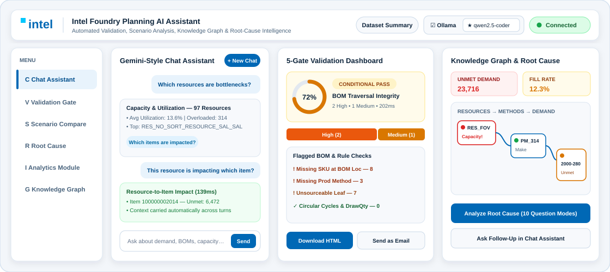
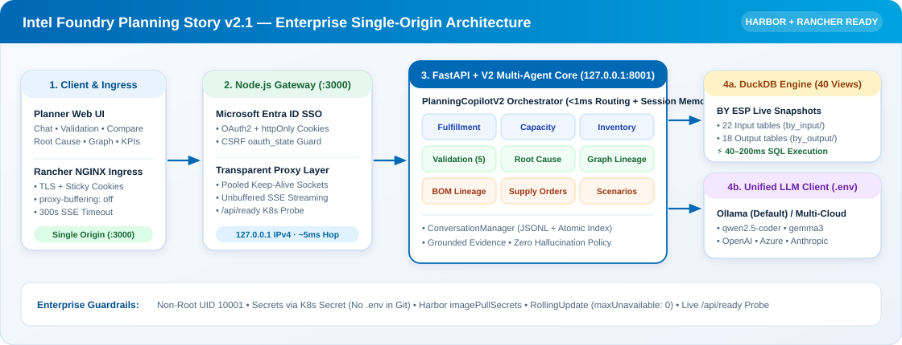
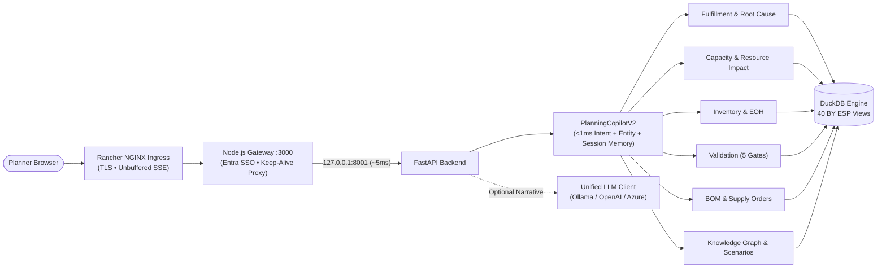
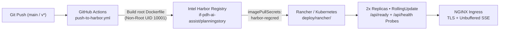

<p align="center">
  
</p>

<h1 align="center">Intel Foundry Planning Story (IFSP v2.1)</h1>

<p align="center">
  <strong>Enterprise Supply Planning AI Assistant &amp; Explainability Platform for Blue Yonder ESP</strong><br/>
  Fast DuckDB-first Multi-Agent Intelligence • Visual Validation Gates • Interactive Supply Lineage • Harbor &amp; Rancher Ready
</p>

<p align="center">
  <a href="https://github.com/jyotiranjanojha/planningstory/actions/workflows/push-to-harbor.yml">
    
  </a>
  
  
  
  
  
</p>

<p align="center">
  <a href="#-workspace-preview">Workspace Preview</a> •
  <a href="#-architecture">Architecture</a> •
  <a href="#-9-specialist-v2-agents">V2 Agents</a> •
  <a href="#-ui-modules">UI Modules</a> •
  <a href="#-quick-start">Quick Start</a> •
  <a href="#-enterprise-deployment-harbor--rancher">Harbor &amp; Rancher</a> •
  <a href="#-api-reference">API Reference</a>
</p>

---

## ✨ Workspace Preview

<p align="center">
  
</p>

**Planning Story** turns complex **Blue Yonder ESP (`by_input/` + `by_output/`)** planning snapshots into instant, grounded, decision-ready answers in **40–400ms** — eliminating manual CSV joins, spreadsheet pivots, and black-box solver guesswork.

| Pillar | What It Delivers |
|---|---|
| **Sub-Second Grounded AI** | DuckDB-first V2 engine registers all **40 BY ESP tables** (22 input + 18 output) into live SQL views — zero hallucinated metrics, deterministic evidence citations. |
| **Conversational Copilot** | Gemini-style streaming Chat Assistant with multi-turn session memory (remembers active item, resource, and topic across follow-ups), Stop/Copy/Regenerate, and one-click follow-up chips. |
| **5-Gate Visual Validation** | Executive SVG Health Donut, Severity Distribution Bar, issue-focused **BOM Traversal Check**, Planning Parameters, Production Route, and Output Sanity gates with HTML Download & Email export. |
| **Interactive Lineage & Root Cause** | Clickable left-to-right **Knowledge Graph** (Resources → Methods → Plants → Supply → Demand) with exception health dots + 10-mode **Root Cause Analyzer** with cross-panel drill-through. |
| **Enterprise Deployment** | Single-origin Node Gateway (`:3000`) + internal FastAPI (`127.0.0.1:8001`), non-root container (`UID 10001`), Microsoft Entra ID SSO, Harbor CI/CD, and Rancher Kubernetes manifests. |

---

## 🏛 Architecture

<p align="center">
  
</p>

### Request & Multi-Agent Routing Flow



---

## 🤖 9 Specialist V2 Agents

All specialist agents live in [`webapp/app/v2/agents/`](webapp/app/v2/agents/) and execute deterministic DuckDB queries directly against live BY ESP views:

| # | Agent | Module | Capabilities | Typical Latency |
|---|---|---|---|---|
| 1 | **FulfillmentAgent** | [`fulfillment.py`](webapp/app/v2/agents/fulfillment.py) | Portfolio, item-level, and dynamic `ITEMCLASS` (e.g., *Stack Silicon*) fill rate, unmet/late demand, and SKU/resource drivers | `60–120ms` |
| 2 | **CapacityAgent** | [`capacity.py`](webapp/app/v2/agents/capacity.py) | Bottleneck/overloaded resources, **resource-to-item demand impact** (`this resource is impacting which item?`), underutilized spare capacity, and capacity exceptions | `40–180ms` |
| 3 | **InventoryAgent** | [`inventory.py`](webapp/app/v2/agents/inventory.py) | On-hand inventory (`if_snop_inventory`), EOH projections, stockouts, and safety-stock risk (`skustatstatic`) | `40–100ms` |
| 4 | **SupplyOrdersAgent** | [`supply_orders.py`](webapp/app/v2/agents/supply_orders.py) | Make vs. Buy mix across `planorder`, `planpurch`, `planarriv`, and `schedrcpts` | `50–120ms` |
| 5 | **BomLineageAgent** | [`bom_lineage.py`](webapp/app/v2/agents/bom_lineage.py) | BOM explosion, where-used lookup, alternate BOMs, and supersession chains | `40–110ms` |
| 6 | **ScenarioAgent** | [`scenario.py`](webapp/app/v2/agents/scenario.py) | Multi-scenario KPI comparison and delta ranking across weeks/runs | `50–120ms` |
| 7 | **ValidationAgent** | [`validation.py`](webapp/app/v2/agents/validation.py) | **5 Validation Gates**: Data Quality, issue-focused **BOM Traversal** (9 structural checks + flagged rows), Production Route, Planning Parameters, and Output Sanity | `80–220ms` |
| 8 | **KnowledgeGraphAgent** | [`graph.py`](webapp/app/v2/agents/graph.py) | Real-edge supply lineage (Resources → Methods → Plants → Supply → Demand) with live exception health overlay and Top Unmet Item catalog | `90–250ms` |
| 9 | **RootCauseAgent** | [`root_cause.py`](webapp/app/v2/agents/root_cause.py) | All 10 planner diagnosis modes (`why_unmet`, `why_late`, `why_short`, `why_early`, `capacity_constraints`, `bom_sourcing_gaps`, `priority_conflict`, `supply_pegging`, `eoh`, `full_diagnosis`) | `150–400ms` |

---

## 🖥 UI Modules

| Panel | Highlights |
|---|---|
| **Chat Assistant** | Gemini-style welcome screen + starter cards, real-time SSE streaming without flicker, **Stop / Copy / Regenerate**, persistent server-side history, true **New Chat** session reset, collapsible Week/Scenario filters, and live **Connected** gateway health pill. |
| **Validation Gate (5 Gates)** | Executive **SVG Health Score Donut (0–100%)**, horizontal stacked **Severity Distribution Bar**, **Flagged BOM Records** table (cycles, missing SKUs, missing production methods, unsourceable leaves), Integrity Rules table, and **HTML Download + Email** on every gate. |
| **Scenario Comparison** | Side-by-side baseline vs. target scenario delta ranking and driver breakdown. |
| **Root Cause Analyzer** | Top Unmet Items quick-pick chips, searchable item datalist, 8-KPI stat strip, 10 question modes, collapsible raw structured data drawer, and one-click drill-through to **Knowledge Graph** and **Chat**. |
| **Analytics Module** | Interactive Demand vs. Supply, Fill Rate, Capacity Utilization, and Met/Unmet/Partially Met trend charts. |
| **Knowledge Graph** | Top Unmet quick-picks, executive KPI strip, curved Bezier lineage flow, red/amber/green health dots, **Bottlenecks-Only** filter, Zoom controls, and click-to-inspect node details. |

---

## 🚀 Quick Start

### 1. Local Development (Windows / Linux)

```bash
# 1. Clone repository
git clone https://github.com/jyotiranjanojha/planningstory.git
cd planningstory

# 2. Configure environment (keep .env local — never commit secrets)
cp .env.example .env

# 3. Install Node & Python dependencies
npm ci
python -m venv .venv
# Windows: .venv\Scripts\activate  |  Linux/macOS: source .venv/bin/activate
pip install -r webapp/requirements.txt
```

**Start locally (Windows):**
```bat
start-ifsp.bat
```
- **Primary Single-Origin UI (Node Gateway):** `http://localhost:3004`
- **Direct Python Backend (no SSO gate):** `http://127.0.0.1:8001`
- **Stop both services:** `stop-ifsp.bat`

### 2. Docker Compose (Single-Origin Container)

```bash
docker compose up --build
# Open http://localhost:3000  |  Readiness check: http://localhost:3000/api/ready
```

---

## ☸ Enterprise Deployment (Harbor + Rancher)



Ready-to-apply Kubernetes / Rancher manifests live in [`deploy/rancher/`](deploy/rancher/):

```bash
# 1. Create namespace & Harbor pull secret + app secrets (see docs/HARBOR_RANCHER_DEPLOYMENT.md)
kubectl apply -f deploy/rancher/namespace.yaml

# 2. Deploy ConfigMap, PVC, Deployment (2 replicas), Service, and SSE-enabled Ingress
kubectl apply -k deploy/rancher/
kubectl -n planningstory rollout status deployment/planningstory
```

📘 **Full step-by-step runbook:** [`docs/HARBOR_RANCHER_DEPLOYMENT.md`](docs/HARBOR_RANCHER_DEPLOYMENT.md)

---

## 🔌 API Reference

<details>
<summary><strong>Click to expand core REST &amp; SSE endpoints (all served on single-origin Node Gateway)</strong></summary>

| Method | Endpoint | Purpose |
|---|---|---|
| `GET` | `/api/health` | Liveness probe (Node Gateway) |
| `GET` | `/api/ready` | **Kubernetes Readiness Probe** (verifies Node + Python + 40 DuckDB views) |
| `GET` | `/api/v2/health` | V2 engine status, DuckDB view count, active LLM provider/model |
| `GET` | `/api/v2/catalog` | Live inventory of all 40 registered BY ESP DuckDB views |
| `GET` | `/api/v2/graph/items` | Top unmet items & selectable catalog for Knowledge Graph / Root Cause |
| `POST` | `/api/chat/stream` | Unbuffered SSE streaming chat (`PlanningCopilotV2` fast path + grounded fallback) |
| `GET/POST` | `/api/conversation/history/:id` & `/clear/:id` | Persistent multi-turn conversation history & clean session reset |
| `POST` | `/api/validate` | Run any of the 5 Validation Gates (`data_quality`, `bom_traversal`, `production_route`, `planning_parameters`, `output_sanity`) |
| `POST` | `/api/validate/report/html` & `/email` | Downloadable HTML report & SMTP email delivery |
| `POST` | `/api/root-cause` | 10-mode DuckDB Root Cause Analyzer |
| `POST` | `/api/knowledge-graph` | Item-scoped supply chain lineage graph with exception health overlay |
| `POST` | `/api/compare` | Scenario comparison & ranked delta metrics |
| `POST` | `/api/insights` | Interactive weekly/quarterly trend analytics |
| `GET` | `/api/llm/models` | Live model discovery for configured LLM provider |

</details>

---

## ⚙️ Configuration & LLM Providers

<details>
<summary><strong>Click to expand .env configuration &amp; multi-provider LLM setup</strong></summary>

Switching LLM providers is a `.env`-only change (`LLM_PROVIDER`):

```dotenv
# Default Local Ollama
LLM_PROVIDER=ollama
OLLAMA_BASE_URL=http://127.0.0.1:11434
OLLAMA_MODEL=qwen2.5-coder:latest
OLLAMA_VISION_MODEL=gemma3:latest

# V2 DuckDB Engine
V2_CORE_ENABLED=true
JUDGE_LLM_ENABLED=false

# Node Gateway -> Internal Python
PORT=3004
PYTHON_BASE_URL=http://127.0.0.1:8001
```

Supported providers: `ollama` (default), `nollama`, `openai`, `azure`, `anthropic`, `openvino`, `custom`. See [`.env.example`](.env.example) and [`docs/LLM_PROVIDER_GUIDE.md`](docs/LLM_PROVIDER_GUIDE.md).

</details>

---

## 🧪 Testing & Verification

```bash
# JS syntax verification (Node Gateway + Frontend)
node --check src/app.js && node --check src/services/pythonProxy.js && node --check webapp/app/static/app.js

# V2 Core & Multi-Agent unit tests (10/10 passing)
pytest -p no:cacheprovider tests/test_v2_core.py -v
```

---

## 📚 Additional Documentation

| Document | Description |
|---|---|
| [`docs/HARBOR_RANCHER_DEPLOYMENT.md`](docs/HARBOR_RANCHER_DEPLOYMENT.md) | Enterprise Harbor + Rancher deployment, secrets, Ingress SSE, and rollback runbook |
| [`HANDOFF.md`](HANDOFF.md) | Complete engineering architecture & handoff summary |
| [`docs/PRD.md`](docs/PRD.md) | Product Requirements Document & roadmap |
| [`docs/LLM_PROVIDER_GUIDE.md`](docs/LLM_PROVIDER_GUIDE.md) | Multi-provider LLM configuration guide |
| [`docs/OPERATIONS_RUNBOOK.md`](docs/OPERATIONS_RUNBOOK.md) | Operational monitoring & troubleshooting guide |
| [`docs/PRODUCTION_READINESS_CHECKLIST.md`](docs/PRODUCTION_READINESS_CHECKLIST.md) | Enterprise security & readiness checklist |
